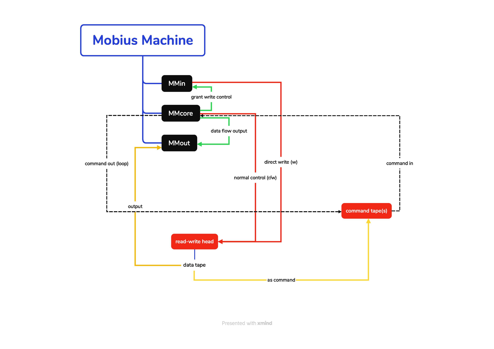
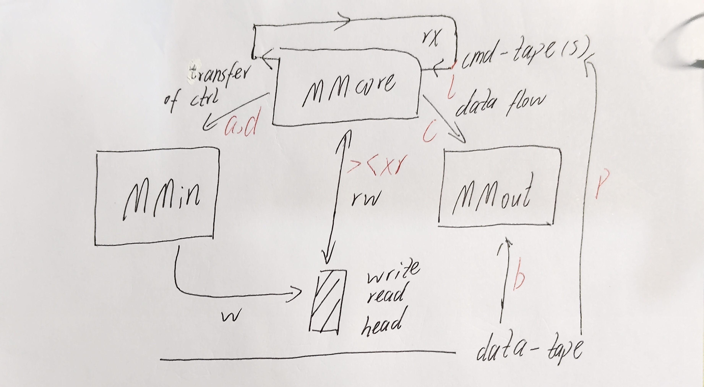
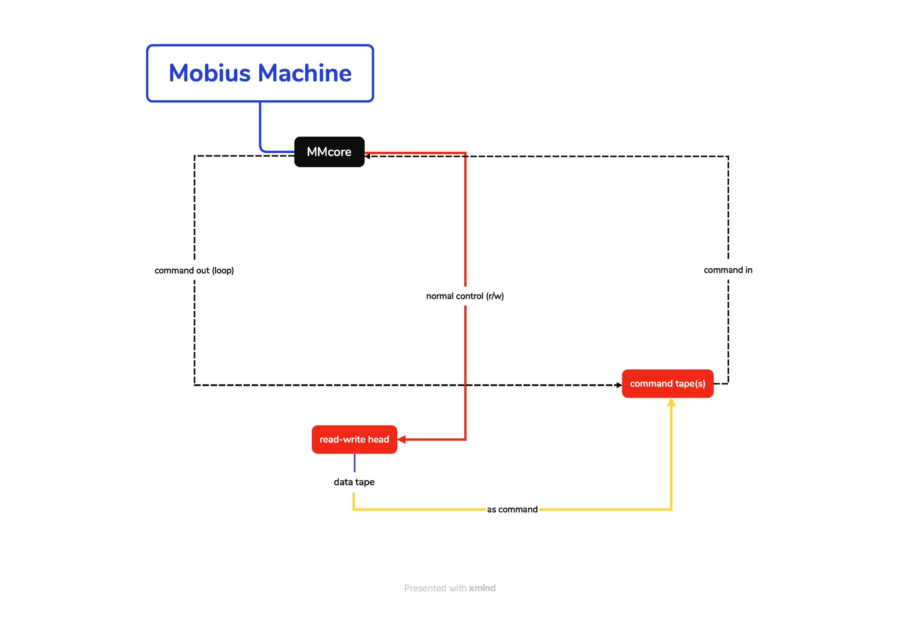
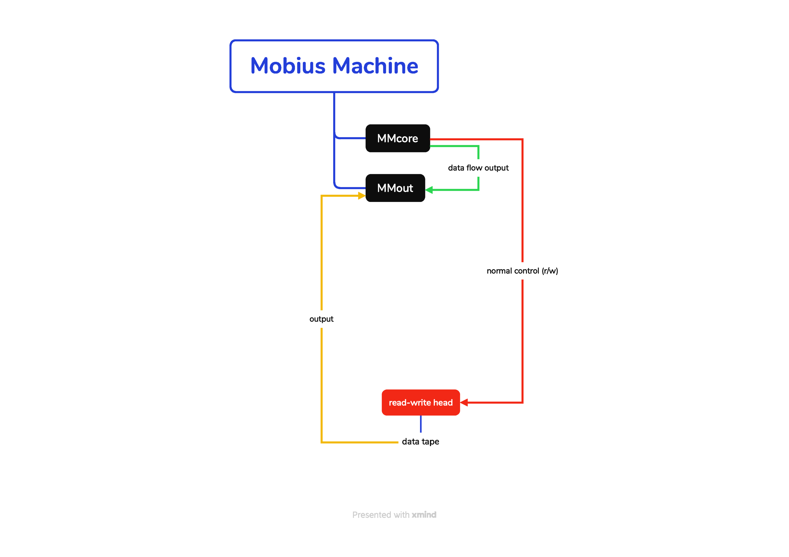
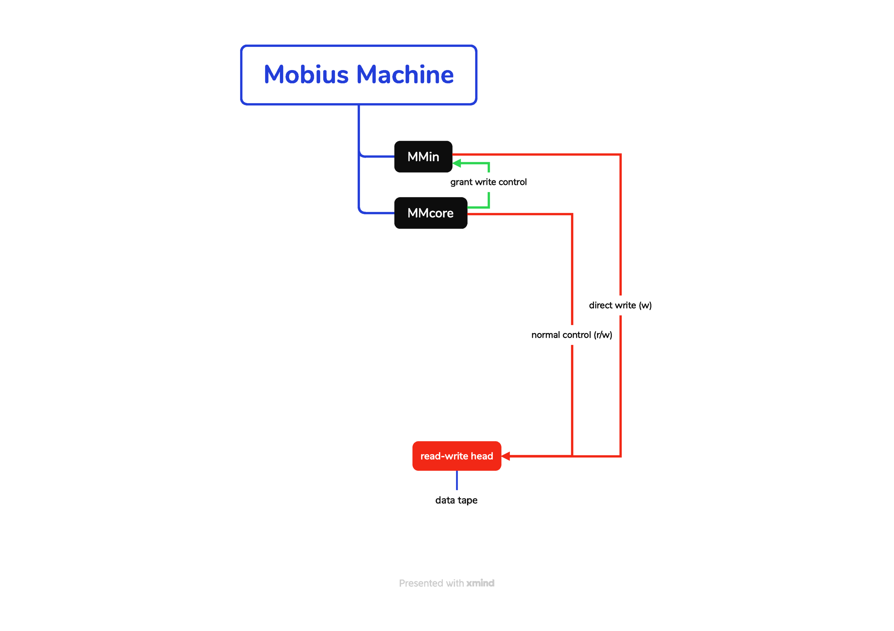

[Chinese README](/README.md) | [English README](/doc-en/README.md)

# Möbius Machine

## Tape System

The Möbius Machine is a variant of a Turing machine in which the read/write head moves bidirectionally along an infinitely long digital data tape. The machine is divided into a program tape and a data tape.

### Program Tape

- Instructions are fed in via the program tape, which is read-only and progresses in a single direction. The two ends of the program tape are physically connected to form a loop, which is optional.
- Program tapes are scheduled in a cyclic sequence. For example, with a sequence of three program tapes, the tape switching order is 1, 2, 3, 1. If there is only one program tape, executing a tape-switch instruction causes it to restart from the beginning.
- When a tape-switch instruction is executed, the machine halts, preserving the current read/write head position and the data tape contents. It then switches to the next program tape in the queue and begins reading from the beginning, while the program counter (PC) state of the previous program tape is lost.
- Before a program starts, any number of program tapes can be inserted into the queue. Once the program begins, only the program itself can add program tapes to the queue.
- The machine supports truncating the current data tape from the right side of the read/write head, taking the truncated left segment as a new program tape and inserting it immediately after the current program tape. At this point, there is no program tape under the read/write head. After this truncation instruction is executed, the machine automatically returns to the beginning of the current program tape before executing the next instruction.

### Addressing

The machine supports a rewind instruction. When executed, it moves the head back to the beginning of the data tape, which makes memory addressing possible.

## Architecture Details

The xmind file is located in the /doc directory.

The original handwritten draft may be clearer and can also be referenced. Expand

The Möbius Machine's I/O system consists of the following three parts: MMin, MMcore, and MMout.

- MMcore is the computational core. It is responsible for executing instructions and managing the transfer of control over the read/write head.
- MMin is the input side, responsible for receiving key presses.
- MMout is the output side, responsible for displaying the computation results on the screen.

### Program Flow

As shown above, the instruction tape itself is a loop structure, with its beginning and end connected.

Furthermore, this machine has the capability for self-generating programs. After a program finishes writing to a tape, that tape can be truncated, converted into a program, and added to the program sequence.

### Output Control

- It supports truncating the data tape as an output.
- Additionally, it supports streaming output from MMcore to MMout.

### Input Control

This is a rather special feature. The machine's input control is not routed through MMcore.

When input is required, MMcore proactively transfers control of the read/write head to MMin. MMin then writes directly to the data tape according to a predefined protocol (typically writing 8 cells). After writing is complete, the read/write head remains at position dp+7, and control is returned.

# Möbius Machine Programming Language

| Mnemonic | Binary | Description | Difference between Virtual Machine and Theoretical Physical Machine |
| :-- | :----- | :-------------------------------------------------------------------- | :------------------------ |
| `>` | `0000` | Move the data read/write head one cell to the right | The virtual machine incurs almost no time cost for moving the read/write head |
| `<` | `0001` | Move the data read/write head one cell to the left | The virtual machine incurs almost no time cost for moving the read/write head |
| `x` | `0010` | Flip the current data cell (0 becomes 1, 1 becomes 0) | None |
| `f` | `0011` | If the current cell is 0, execute the next instruction normally; if it is 1, skip the next instruction (PC+2) | None |
| `s` | `0100` | Tape switch and halt: suspend the current program tape, discard the PC, and switch to the next program tape in the scheduling queue (reading from the beginning of the new tape); the data tape and read/write head position are fully preserved | None |
| `b` | `0101` | Truncate the entire current data tape from the right side of the read/write head and output the truncated left segment as the computation result. Does not halt. | None |
| `p` | `0110` | Truncation snapshot: truncate from the right side of the read/write head, take the truncated data tape segment as a new program tape, and insert it into the program tape sequence immediately after the current program tape | None |
| `n` | `0111` | No operation | Also used as a breakpoint in the debugger |
| `l` | `1000` | **Only at the end of a program tape**: When this instruction is reached, the command tape automatically loops back | The physical machine's tape forms a closed loop; in the virtual machine, this serves to reset the PC |
| `r` | `1001` | Rewind instruction. After execution, the head moves back to the beginning of the data tape, making memory addressing possible. **Note: `p` may change the position of data because data tape truncation alters the origin** | The virtual machine incurs almost no time cost for moving the read/write head |
| `a` | `1010` | Blockingly get input, defined as getting the current input. The result is the ASCII code of the key pressed. MMcore hands control of the read/write head to MMin, which writes 8 cells and then returns control. Only single-key presses are supported | The virtual machine uses standard input `input()`, which requires a carriage return to confirm |
| `d` | `1011` | Similar to `a`, but non-blocking. Defined as checking for current input. If no key is pressed, the result is `11111111` | **Not yet implemented** — the current virtual machine will report an error for this instruction |
| `c` | `1100` | Send the binary value of the cell under the current read/write head to MMout | None |
| `!` | `1101` | Halt immediately | None |

 

The language is case-sensitive. Anything not in the instruction set is considered a comment.

For example, using `[\?]` to represent the read/write head:

**`b` instruction**: \
Original data: `1111 11[1]0 000`\
Output data: `1111 111`, meaning the right side is discarded

**`p` instruction**:
Original data: `0000 0111 011[1] 1000`\
Output code: `0000 0111 0111`, which is `>nn`. The remaining data tape and read/write head are `[?]1000`. Since there is no data tape under the read/write head at this point, the machine automatically resets the data pointer (dp) to zero (i.e., returns to the beginning of the data tape) before executing the next instruction. Thus, before the next instruction, the data tape and read/write head are `[1]000`.

\*\* `a` and `d` instructions \*\*

Original data: `1111 1111 [1]111`\
Assuming the key pressed is `a`, the output data is `1111 1111 0110 000[1]`, where `01100001` is the ASCII code of `a`.

Original data: `[0]`
Assuming the key pressed is `a`, the output data is `0110 000[1]`

**`d` instruction**

Original data: `[0]`
If no key is pressed, the output data is `1111 111[1]`

## Special Syntax for Assembly-Time Preprocessing

| Symbol | Purpose |
| :---------------------------- | :------------------------------------------- |
| (...)\*114514 | Repetition syntax. It is expanded during preprocessing. For example, `(>)*1024` is expanded into 1024 `>` characters |
| (...)\*$REPEAT-NUMBER | Repetition syntax with a constant |
| (...)?1 | Selection syntax, which determines whether this code segment is assembled into the program. It is followed by 0 or 1 |
| (...)?$ENABLE | Selection syntax with a constant |
| (...)?1\*114514 | Selection-repetition syntax. `?` must come before `*` |
| (...)?$ENABLE\*$REPEAT-NUMBER | Selection-repetition syntax with a constant |
| #0 | Program tape label. Appears in `.mmlang` and `.mmbin` files to distinguish program tapes. Labels start at 0 and increment |
| // | Comment. Appears in `.mmlang` files to comment code |
| $XX-XXX=114514 | Define a constant. Used in conjunction with the `*` repetition syntax. Defined at the beginning of the file, one per line, limited to non-negative integers |

Except for `#0`, other tokens will not be passed through to the `.mmbin` file as-is.
